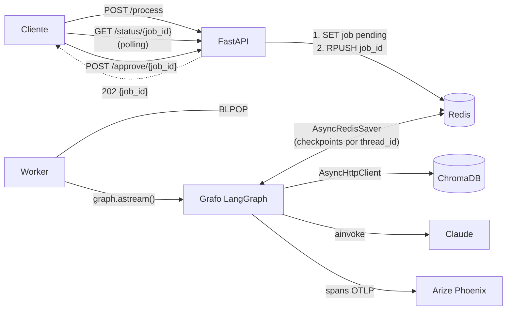
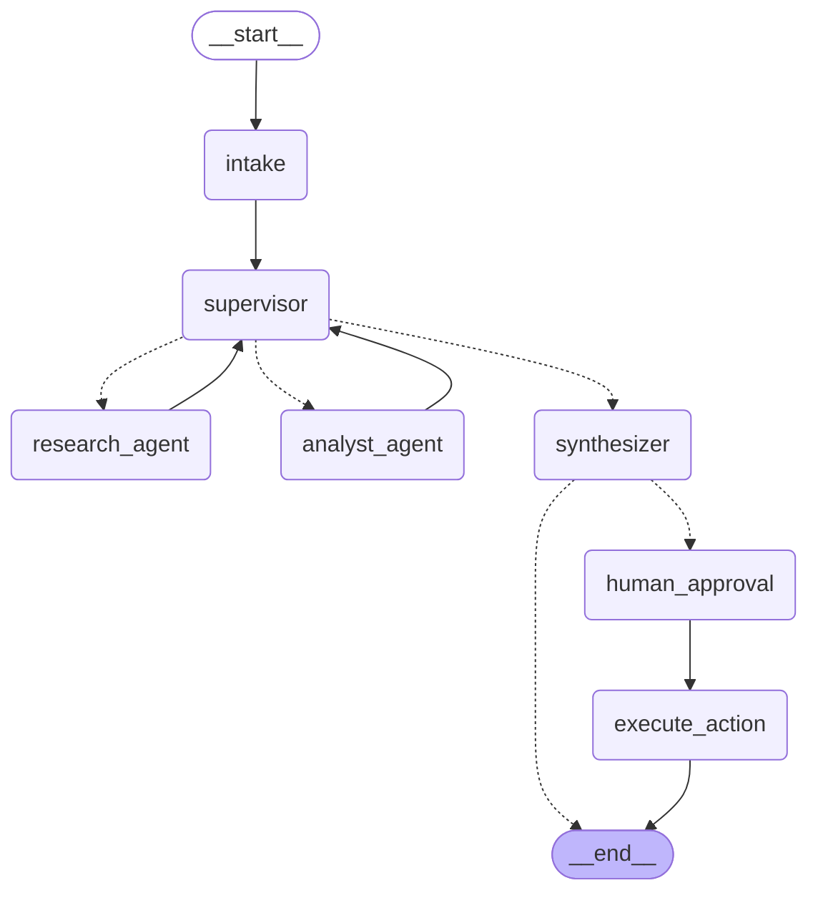
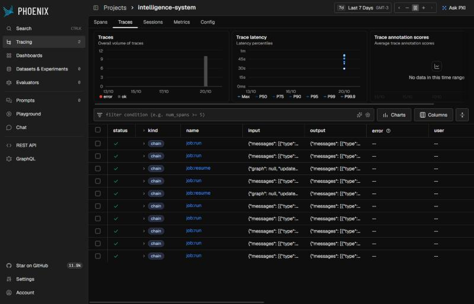
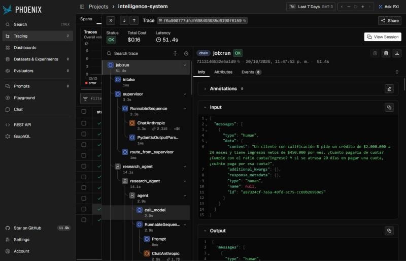
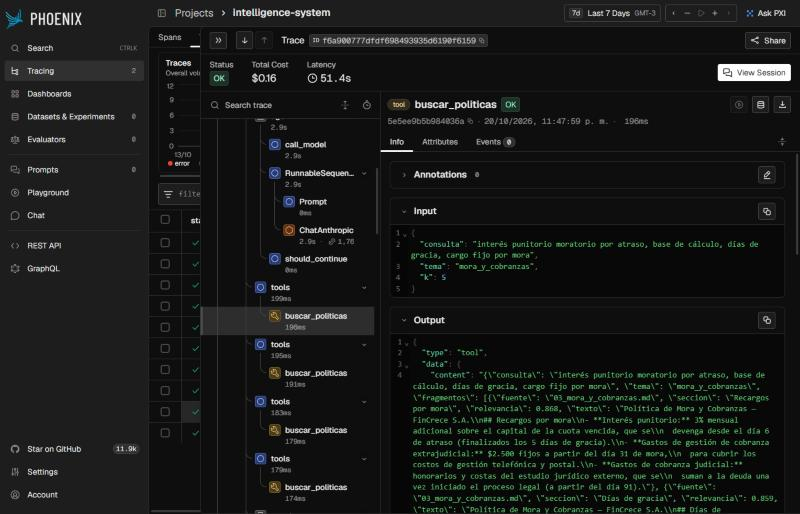
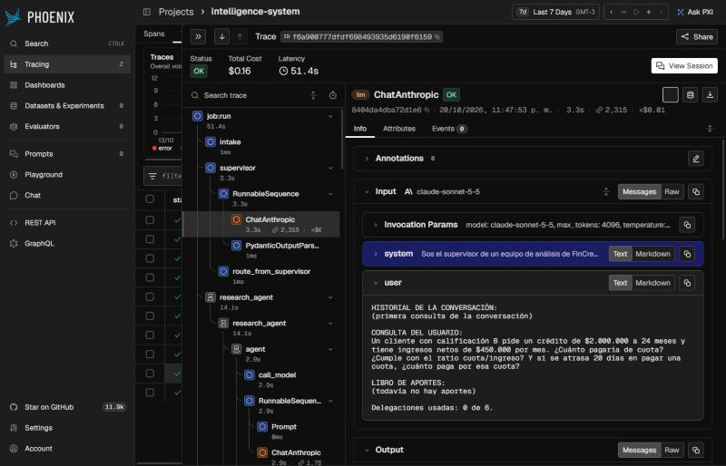
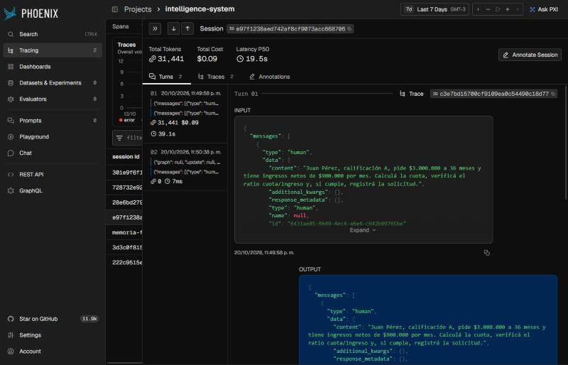
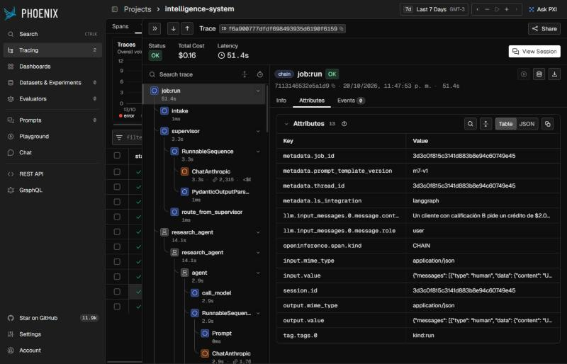

# The Intelligence System — FinCrece S.A.

**Entrega final · AI Engineering · Módulo 8**

Sistema de IA de grado de producción que integra **RAG + agentes con Supervisor + API profesional + trazabilidad**. Ensambla y refactoriza en un único repositorio las pre-entregas de los módulos anteriores (principalmente la 6 y la 7): todo asíncrono, con **Checkpointer de LangGraph** para persistir conversaciones y **Pydantic** en cada frontera del sistema.

**La tarea que resuelve.** Un analista de créditos pregunta en lenguaje natural ("¿cuánto paga de cuota este cliente?, ¿cumple el ratio cuota/ingreso?, registrá la solicitud") y el sistema:

1. **Busca** la política aplicable en la base documental (RAG) y cita la fuente.
2. **Calcula** con herramientas deterministas (cuota francesa, ratio, recargo por mora).
3. **Valida** cada aporte con una rúbrica antes de seguir (Supervisor).
4. **Redacta** la respuesta final citando archivo y sección.
5. Si se pidió, **registra la solicitud**, con **aprobación humana** cuando el monto es alto (HITL).

Todo queda trazado en **Arize Phoenix**: cada nodo, cada llamada al LLM y cada tool.

---

## Índice

- [Levantar el sistema (una sola instrucción)](#levantar-el-sistema-una-sola-instrucción)
- [El camino recorrido: de las pre-entregas al sistema](#el-camino-recorrido-de-las-pre-entregas-al-sistema)
- [Arquitectura](#arquitectura)
- [Grafo de agentes](#grafo-de-agentes)
- [Human-in-the-Loop](#human-in-the-loop)
- [Persistencia: Checkpointer de LangGraph](#persistencia-checkpointer-de-langgraph)
- [API](#api)
- [Validación con Pydantic](#validación-con-pydantic)
- [Todo asíncrono](#todo-asíncrono)
- [Observabilidad y pruebas del sistema](#observabilidad-y-pruebas-del-sistema)
- [Tests unitarios](#tests-unitarios)
- [Configuración](#configuración)
- [Estructura del repositorio](#estructura-del-repositorio)
- [Decisiones de arquitectura](#decisiones-de-arquitectura)
- [Cumplimiento de la consigna y la rúbrica](#cumplimiento-de-la-consigna-y-la-rúbrica)

---

## Levantar el sistema (una sola instrucción)

**Requisitos:** Docker con Docker Compose y una API key de Anthropic. No hace falta Python local.

```bash
git clone <url-del-repo> && cd <repo>
cp .env.example .env      # completar ANTHROPIC_API_KEY
./run.sh                  # equivale a: docker compose up --build -d
```

`run.sh` crea el `.env` si falta, verifica que la API key esté cargada, levanta los cinco servicios y espera a que la API responda en `/health`.

| Servicio | URL | Qué es |
|---|---|---|
| API | http://localhost:8000/docs | FastAPI con Swagger (documentación interactiva) |
| Phoenix | http://localhost:6006 | Trazas (proyecto `intelligence-system`) |
| Chroma | http://localhost:8001 | Base vectorial |
| Redis | localhost:6379 | Cola, estado de jobs, checkpointer y solicitudes |

```bash
./run.sh logs    # sigue los logs de api y worker
./run.sh down    # detiene todo sin borrar los volúmenes
```

La primera vez el worker descarga el modelo de embeddings (`intfloat/multilingual-e5-base`, ~1 GB, queda cacheado en un volumen) e indexa `data/` en Chroma. El avance se ve con `./run.sh logs`.

> **Alcance del despliegue:** local con Docker Compose / `run.sh`, como pide la consigna. No incluye CI/CD ni infraestructura en la nube.

---

## El camino recorrido: de las pre-entregas al sistema

Cada módulo del programa aportó una capa. Esta tabla muestra dónde vive cada una en el código final.

| Módulo | Qué aportó | Dónde está en este repo |
|---|---|---|
| **1 · Asyncio aplicado a IA** | `async/await`, event loop, `gather`, timeouts, resiliencia, no bloquear el loop | Todo el sistema es `async`. El worker corre `WORKER_CONCURRENCY` consumidores con `asyncio.gather` en un mismo loop; `BLPOP` con timeout para cierre ordenado; embeddings en CPU con `asyncio.to_thread`. |
| **2 · LCEL, validación y resiliencia** | Runnables, Pydantic, `with_structured_output`, reintentos | `SupervisorDecision` y `SynthesisOutput` como salida estructurada; LLM con `max_retries`; reintento al indexar si Chroma todavía no está listo. |
| **3 · Embeddings, chunking y ChromaDB** (PE3) | RAG local con ChromaDB + Pydantic | `app/rag/`: un fragmento por sección `##` con metadata (`source`, `section`, `tema`), embeddings e5, `upsert` idempotente. |
| **4 · RAG escalable con metadatos** (PE4) | Ingesta en lote, metadatos estrictos, filtros | La tool `buscar_politicas` filtra por `tema: Literal[...]` sobre la metadata. Se mantuvo ChromaDB (ver [decisiones](#decisiones-de-arquitectura)). |
| **5 · LangGraph: agente ReAct** (PE5) | Estado, nodos/aristas, tool calling, ciclo ReAct, checkpointers | Los especialistas son agentes ReAct con tools `async` validadas con Pydantic; el grafo compila con checkpointer. |
| **6 · Multi-agente con Supervisor** (PE6) | Topología jerárquica, rúbrica, condición de parada, estado compartido | `app/graph/supervisor.py`, `app/graph/agents/`, `app/graph/state.py` (libro de aportes). |
| **7 · Producción: observabilidad, FastAPI + Redis, HITL** (PE7) | Phoenix, cola + worker + polling, `interrupt()`, checkpointer en Redis | `app/main.py`, `app/worker.py`, `app/jobs.py`, `app/tracing.py`, nodos `human_approval` y `execute_action`. |
| **8 · Entrega final** | Integración, refactor async, persistencia, validación, trazas, README, despliegue | Este repositorio. |

---

## Arquitectura



**Capas:**

| Capa | Responsabilidad | Código |
|---|---|---|
| API | Validar, encolar, exponer estado. No ejecuta IA. | `app/main.py`, `app/schemas.py` |
| Cola y jobs | Estado del job y lock por conversación | `app/jobs.py` |
| Worker | Consumir la cola y ejecutar / reanudar el grafo | `app/worker.py` |
| Grafo de agentes | Supervisor, especialistas, síntesis, HITL | `app/graph/` |
| Conocimiento (RAG) | Ingesta y recuperación | `app/rag/` |
| Acciones | Único efecto real: registrar la solicitud | `app/actions.py` |
| Observabilidad | Registro de Phoenix e instrumentación | `app/tracing.py` |
| Configuración | Variables de entorno tipadas | `app/config.py` |

**Puntos clave:**

- **La API no ejecuta IA.** Valida con Pydantic, guarda el job como `pending` y **después** lo encola (así nunca devuelve un 404 falso) y responde en milisegundos.
- **El worker** (`python -m app.worker`) es un proceso aparte que escala con más réplicas.
- **Una conversación = un `thread_id`.** La API admite un solo job activo por hilo (`409` si ya hay uno), porque dos turnos concurrentes pisarían el checkpoint.
- **Ciclo de vida de un job:** `pending → processing → completed | awaiting_approval | failed`. Si queda en `awaiting_approval`, `POST /approve` lo reencola como `resume` y el worker reanuda el hilo con `Command(resume=...)`.

---

## Grafo de agentes



Generado con `graph.get_graph().draw_mermaid()`. Las líneas punteadas son aristas condicionales.

**Flujo típico de una consulta multi-paso:**
`intake → supervisor → research_agent → supervisor → analyst_agent → supervisor → synthesizer → (human_approval → execute_action) → END`

| Nodo | Qué hace |
|---|---|
| `intake` | Abre un turno nuevo en el hilo: incrementa `turn` y reinicia el contador de pasos y el estado de la acción. |
| `supervisor` | Decide con salida estructurada (`SupervisorDecision`, `next: Literal[...]`) quién interviene o si termina. Aplica una rúbrica al último aporte y devuelve la tarea al especialista si falla un criterio. Ve el historial para resolver seguimientos ("¿y a 36 meses?"). |
| `research_agent` | Agente ReAct con la tool `buscar_politicas` (RAG). Cita archivo y sección de cada dato. No calcula. |
| `analyst_agent` | Agente ReAct con `calcular_cuota_frances`, `evaluar_ratio_cuota_ingreso` y `calcular_recargo_mora`. Todo número sale de una tool; los parámetros de política salen del investigador. |
| `synthesizer` | Redacta la respuesta final usando solo el libro de aportes. Con `SynthesisOutput` propone, si el usuario lo pidió y el caso cumple la política, una solicitud a registrar. |
| `human_approval` | Si la solicitud supera `HITL_MONTO_UMBRAL`, llama a `interrupt()` y el grafo queda pausado. Si no, la aprueba sola y lo deja registrado como `automatica`. |
| `execute_action` | Único nodo con efecto real: registra la solicitud en Redis (o deja constancia del rechazo). |

### Estado compartido

El estado (`app/graph/state.py`) hereda de `MessagesState` y agrega un **libro de aportes** para rastrear qué agente contribuyó con qué información:

| Campo | Quién lo escribe | Para qué |
|---|---|---|
| `contributions` | especialistas | Paso, agente, tarea recibida, entrega y tools usadas con sus argumentos. Reducer `operator.add`: solo se agrega. |
| `decisions` | supervisor | Historial de ruteo: evaluación de la rúbrica, destino e instrucción. |
| `next_agent`, `instruction` | supervisor | Destino e instrucción vigentes. |
| `step_count`, `stop_reason` | supervisor | Delegaciones hechas y motivo de cierre (suficiencia o límite de pasos). |
| `turn`, estado de la acción / aprobación | `intake`, síntesis, HITL | Turnos de la conversación y ciclo de la solicitud. |

### Rúbrica del supervisor

- **Investigador** — R1: cada dato cita su archivo fuente. R2: cubre todos los datos de política que la consulta necesita. R3: no hay datos sin respaldo en una búsqueda.
- **Analista** — A1: cada resultado sale de una tool de cálculo. A2: los argumentos coinciden con los datos del investigador y del caso. A3: cubre todas las partes cuantitativas.

A1 y A2 se pueden verificar porque el libro de aportes registra las tools usadas con sus argumentos.

### Condición de parada y contexto acotado

- **Supervisor infinito:** tres frenos. (1) Criterio de suficiencia en el prompt. (2) `step_count` contra `MAX_STEPS`: al agotarse, el supervisor finaliza **sin consultar al LLM** y la síntesis avisa qué quedó incompleto (y no propone registrar nada). (3) `recursion_limit` del grafo y de cada especialista como red de seguridad.
- **Contaminación de contexto:** ningún especialista ve el historial completo. Reciben la instrucción autocontenida del supervisor y, el analista, las entregas del investigador. Sus mensajes internos (tool calls) no suben al estado compartido; sí quedan en la traza.

### Manejo de conflictos entre agentes

- **Fuente de verdad por dominio:** en datos de política manda el investigador (cita la fuente); en números manda el analista (usa tools).
- **Cálculo con un dato distinto al investigado:** lo detecta A2 y se rehace con el valor del investigador.
- **Al analista le falta un dato:** no lo inventa; lo informa, el supervisor se lo pide al investigador y vuelve al analista.
- **Varias entregas del mismo especialista:** vale la más reciente.
- **Escrituras al estado:** los especialistas solo agregan; los campos de ruteo los escribe únicamente el supervisor, que delega de a uno por vez.

---

## Human-in-the-Loop

Solo la acción con efecto real pasa por un humano, y solo cuando es de alto monto: validar el 100% de las respuestas sería un cuello de botella.

1. El `synthesizer` propone la solicitud. La propuesta del LLM se revalida contra `SolicitudCredito` (monto entre $300.000 y $8.000.000; plazos 6/12/18/24/36/48). Si no pasa, se descarta en código y la respuesta lo explica.
2. `human_approval` hace `interrupt(ApprovalRequest)`. El checkpointer guarda el hilo y el job queda `awaiting_approval` con la pregunta en `approval_request`.
3. El revisor responde `POST /approve/{job_id}` con `{"aprobado": true|false, "revisor": "...", "comentario": "..."}`.
4. Al reanudar, `human_approval` se re-ejecuta desde el principio, por eso **no tiene efectos antes del `interrupt()`**. El registro está en `execute_action`, con id determinista (`SOL-{thread}-{turno}`) y `SET NX`: si el nodo se re-ejecuta no se duplica.
5. Queda auditoría: quién aprobó, cuándo, con qué comentario y sobre qué datos (`GET /status/{job_id}` y `GET /solicitudes`).

---

## Persistencia: Checkpointer de LangGraph

- El grafo compila con **`AsyncRedisSaver`** (`langgraph-checkpoint-redis`), inicializado con `await checkpointer.asetup()` en la API y en el worker.
- El estado se guarda **por `thread_id`** después de cada nodo. Una conversación sigue en el mismo hilo: un seguimiento ("¿y a 36 meses?") recupera monto y calificación del turno anterior.
- Redis corre con **AOF** (`--appendonly yes`) y volumen propio: los checkpoints, los jobs y los grafos pausados por HITL **sobreviven a un reinicio** del servidor.
- `GET /threads/{thread_id}` lee el historial directamente del checkpointer.
- Se verifica con el escenario e2e 8: un hilo pausado sobrevive a `docker compose restart api worker` y se aprueba después.

---

## API

| Método | Ruta | Descripción |
|---|---|---|
| `POST` | `/process` | Encola una consulta. Body `ProcessRequest {query, thread_id?}`. Responde `202 JobAccepted`. `409` si el hilo tiene un job activo. |
| `GET` | `/status/{job_id}` | `JobRecord`: estado, pregunta de aprobación, decisión, resultado (respuesta, recorrido, aportes, acción) o error. |
| `POST` | `/approve/{job_id}` | `ApprovalDecision {aprobado, revisor, comentario?}`. `409` si el job no espera aprobación o ya se respondió. |
| `GET` | `/threads/{thread_id}` | Historial de la conversación leído del checkpointer. |
| `GET` | `/solicitudes` | Solicitudes registradas, con su aprobación. |
| `GET` | `/health` | Estado de la conexión a Redis. |

Documentación interactiva en **http://localhost:8000/docs**.

**Ejemplo de punta a punta:**

```bash
curl -s -X POST localhost:8000/process -H "Content-Type: application/json" \
  -d '{"query": "Juan Pérez, calificación A, pide $3.000.000 a 36 meses con ingresos de $900.000. Calculá la cuota, verificá el ratio y registrá la solicitud."}'
# {"job_id":"3f2c...","thread_id":"3f2c...","status":"pending","status_url":"/status/3f2c..."}

curl -s localhost:8000/status/3f2c...           # processing → awaiting_approval

curl -s -X POST localhost:8000/approve/3f2c... -H "Content-Type: application/json" \
  -d '{"aprobado": true, "revisor": "ana.risk"}'

curl -s localhost:8000/status/3f2c...           # completed, accion.estado = "registrada"
```

**Seguimiento en la misma conversación:**

```bash
curl -s -X POST localhost:8000/process -H "Content-Type: application/json" \
  -d '{"query": "¿Y si lo pide a 48 meses?", "thread_id": "3f2c..."}'
```

---

## Validación con Pydantic

| Frontera | Modelos |
|---|---|
| Entrada de la API | `ProcessRequest` (largo de la consulta, patrón de `thread_id`, sin campos extra), `ApprovalDecision`, `job_id` validado por patrón en la ruta. |
| Salida de la API | `JobAccepted`, `JobRecord`, `ThreadView`, `SolicitudRegistrada`, `HealthResponse` (`response_model` en cada endpoint). |
| Tools de los agentes | Entrada: `SearchQuery` (con `tema: Literal[...]` para filtrar por metadata), `CuotaInput`, `RatioInput`, `MoraInput`. Salida: `SearchResult`, `CuotaResultado`, `RatioResultado`, `MoraResultado`. Si el LLM manda un argumento inválido, `ToolNode` le devuelve el error y el agente corrige la llamada. |
| Salidas del LLM | `SupervisorDecision` y `SynthesisOutput` (salida estructurada). La solicitud propuesta se revalida contra `SolicitudCredito`, con los límites de la política. |
| HITL | `ApprovalRequest` (payload del `interrupt`), `ApprovalRecord`, `ActionOutcome`. |
| RAG | `Chunk` en la ingesta (texto + `source`, `section`, `tema`). |
| Configuración | `Settings` (pydantic-settings) desde variables de entorno; la API key como `SecretStr`. |

En el estado del grafo se guardan dicts (`model_dump()`) para que el checkpointer los serialice sin registrar tipos propios. Se validan cada vez que entran o salen del grafo.

---

## Todo asíncrono

| Componente | Cómo |
|---|---|
| LLM | `ChatAnthropic.ainvoke` (supervisor, síntesis) y `agent.ainvoke` (especialistas ReAct). |
| Vector DB | ChromaDB en modo servidor con `chromadb.AsyncHttpClient` (`query`, `upsert`, `count` con `await`). |
| Redis | `redis.asyncio` para cola y estado; `AsyncRedisSaver` para el checkpointer. |
| Tools | Todas `async def`. |
| Grafo | `graph.astream()` en el worker. |
| Embeddings | `sentence-transformers` en CPU: no es I/O, así que corre en `asyncio.to_thread` para no bloquear el event loop. |
| Tests e2e | `httpx.AsyncClient`. |

No hay `requests` ni llamadas síncronas de red dentro de funciones `async def`.

---

## Observabilidad y pruebas del sistema

`app/tracing.py` llama a `phoenix.otel.register(auto_instrument=True)`. El instrumentador de LangChain de OpenInference envía cada nodo del grafo, cada llamada al LLM (con tokens, latencia y costo) y cada tool como spans al Phoenix del compose.

- **Sesiones:** cada job corre dentro de `using_attributes(session_id=thread_id)`, así que Phoenix agrupa todas las trazas de una conversación, incluida la reanudación después de la aprobación.
- **Versión de prompts:** cada traza lleva `prompt_template_version` en la metadata y como tag (constante `PROMPT_TEMPLATE_VERSION` en `app/graph/builder.py`).
- **Metadata del job:** `job_id` y `kind` (`run` / `resume`) para cruzar la traza con `GET /status`.

### Pruebas del sistema (≥ 5, con trazas)

`tests/e2e/test_scenarios.py` corre contra el sistema levantado; cada escenario deja su traza en Phoenix.

```bash
pip install -r requirements-dev.txt
pytest tests/e2e -v -s                                # escenarios 1 a 7
E2E_RESTART=1 pytest tests/e2e -v -s -k reinicio      # 8: reinicia api y worker
```

| # | Escenario | Qué verifica |
|---|---|---|
| 1 | RAG sin cálculos | Ruteo dinámico: supervisor → investigador → síntesis, sin analista. |
| 2 | Multi-paso | Investigador antes que analista; usa búsqueda, cuota y ratio. |
| 3 | Memoria conversacional | Un seguimiento en el mismo hilo toma monto y calificación del turno anterior. |
| 4 | HITL aprobado | Pausa en `awaiting_approval`, aprobación, solicitud registrada con revisor. |
| 5 | HITL rechazado | Rechazo con comentario; no se registra nada. |
| 6 | Bajo el umbral | Se aprueba sola (`modo: automatica`). |
| 7 | Validación y errores | 422, 404 y 409 de la API. |
| 8 | Persistencia tras reinicio | Un hilo pausado sobrevive a `docker compose restart api worker` y se aprueba después. |

### Evidencia de trazas

Corrida de los escenarios 1 a 7: 10 trazas (8 `job:run` y 2 `job:resume`), 7 sesiones, 482 spans (63 llamadas al LLM, 40 a tools).

**Lista de trazas.** Una por ejecución de job. Las dos `job:resume` son las reanudaciones después de `/approve`.



**Traza multi-paso (escenario 2).** Árbol completo `intake → supervisor → research_agent → … → synthesizer`, con costo total y latencia. Se ve dónde está el cuello de botella: en los especialistas, no en el supervisor.



**Span de la tool RAG.** `buscar_politicas` con su entrada validada (consulta, `tema` como filtro de metadata, `k`) y los fragmentos recuperados con fuente, sección y relevancia. Es el span que hay que mirar antes de tocar un prompt: si el retriever no trajo el dato, el problema es de recall.



**Span LLM del supervisor.** Modelo, tokens y el prompt real: historial, consulta, libro de aportes y delegaciones usadas.



**Sesión de un HITL (escenario 4).** El turno 1 (`job:run`) termina en el `interrupt()`; el turno 2 (`job:resume`) es la reanudación después de la aprobación. Ambas trazas quedan agrupadas por `thread_id`.



**Metadata de la traza.** `job_id`, `thread_id`, `session.id` y `prompt_template_version`.



---

## Tests unitarios

```bash
pip install -r requirements-dev.txt
pytest tests/unit -q
```

Corren sin red: LLM con salidas guionadas, Redis en memoria (fakeredis) y checkpointer en memoria. Cubren las tools (cálculos y rechazo de argumentos inválidos), la ingesta, el corte por límite de pasos, los tres caminos del HITL (aprobado, rechazado, automático), el descarte de propuestas fuera de política, la memoria por hilo y la API con el worker (códigos 202/404/409/422 y el ciclo completo de aprobación).

---

## Configuración

Todo sale de variables de entorno ([.env.example](.env.example)). En el código no hay claves, modelos, colecciones ni URLs.

| Variable | Default | Descripción |
|---|---|---|
| `ANTHROPIC_API_KEY` | — | Obligatoria. Se lee como `SecretStr`. |
| `ANTHROPIC_MODEL` | — | Obligatoria. Modelo del supervisor, los especialistas y la síntesis. |
| `CHROMA_COLLECTION` | — | Obligatoria. Colección de Chroma. |
| `EMBEDDING_MODEL` | — | Obligatoria. Modelo de embeddings (familia e5). |
| `MAX_STEPS` | `6` | Delegaciones máximas por consulta. |
| `HITL_MONTO_UMBRAL` | `1000000` | Desde este monto, registrar requiere aprobación humana. |
| `QUEUE_NAME` | `intelligence:jobs` | Cola de Redis. |
| `WORKER_CONCURRENCY` | `2` | Consumidores por worker. |
| `TRACING_ENABLED` | `true` | Envío de trazas a Phoenix. |
| `PHOENIX_PROJECT_NAME` | `intelligence-system` | Proyecto en Phoenix. |
| `REDIS_URL`, `CHROMA_HOST`, `CHROMA_PORT`, `PHOENIX_COLLECTOR_ENDPOINT` | localhost | En Docker las fija `docker-compose.yml`. |

**Entorno y estándares:** Python **3.12** (declarado en `pyproject.toml` con `requires-python = ">=3.12"` y en la imagen `python:3.12-slim`); dependencias con versión fija en `requirements.txt` / `requirements-dev.txt`; `.env` fuera de git.

---

## Estructura del repositorio

```
├── app/
│   ├── main.py              # FastAPI: /process, /status, /approve, /threads, /solicitudes
│   ├── worker.py            # Consumidor de la cola → graph.astream / Command(resume)
│   ├── jobs.py              # Cola y estado de jobs en Redis, lock por thread
│   ├── actions.py           # Registro de solicitudes (efecto real, idempotente)
│   ├── config.py            # Settings (pydantic-settings) y creación del LLM
│   ├── schemas.py           # Modelos Pydantic de la API y del dominio
│   ├── tracing.py           # register() de Phoenix
│   ├── graph/
│   │   ├── state.py         # Estado compartido: mensajes + libro de aportes + turnos + HITL
│   │   ├── supervisor.py    # Rúbrica, decisión estructurada y arista condicional
│   │   ├── builder.py       # intake, síntesis, HITL, acción y StateGraph
│   │   └── agents/
│   │       ├── research_agent.py   # buscar_politicas (RAG)
│   │       ├── analyst_agent.py    # cuota, ratio, mora
│   │       └── common.py           # Adaptador especialista ↔ estado
│   └── rag/
│       ├── ingest.py        # Fragmentos por sección + metadata → Chroma (upsert)
│       └── retriever.py     # AsyncHttpClient + embeddings e5
├── data/                    # Políticas de crédito de FinCrece S.A.
├── tests/
│   ├── unit/                # Sin red
│   └── e2e/                 # Contra el sistema levantado (generan trazas)
├── docs/traces/             # Capturas de Phoenix
├── docker-compose.yml       # api + worker + redis + chroma + phoenix
├── Dockerfile
├── run.sh
├── pyproject.toml
├── .env.example
├── requirements.txt / requirements-dev.txt
└── README.md
```

### Correr fuera de Docker (desarrollo)

Hace falta un Redis con RedisJSON y RediSearch (Redis 8 o `redis/redis-stack-server`), un servidor Chroma y, opcionalmente, Phoenix:

```bash
python3.12 -m venv .venv && source .venv/bin/activate
pip install -r requirements-dev.txt
pip install chromadb==1.5.9 && chroma run --path ./chroma --port 8001   # servidor Chroma
uvicorn app.main:app --port 8000      # en otra terminal
python -m app.worker                  # en otra terminal
```

---

## Decisiones de arquitectura

- **Topología jerárquica (Supervisor).** La consulta típica tiene dependencia de orden: el cálculo necesita datos de política que primero hay que buscar. Un pipeline fijo no sirve cuando la consulta necesita un solo dominio ni permite volver atrás; una red entre pares reparte la decisión de cuándo terminar, que es la que produce bucles. El supervisor concentra en un solo lugar quién interviene, si el aporte es suficiente y cuándo se termina. Sumar un tercer especialista es agregar un nodo y una línea al prompt.
- **Síntesis como nodo aparte.** La decisión de ruteo queda como salida estructurada corta y la redacción final tiene su propio prompt.
- **Tools sin valores de política.** Tasas, topes y días de gracia entran como argumentos: el analista depende de lo que encontró el investigador, y la rúbrica puede verificarlo.
- **API desacoplada del cómputo (cola + worker + polling).** Una corrida del grafo tarda decenas de segundos; la API responde en milisegundos y el worker escala por separado.
- **HITL solo en la acción con efecto real y de alto monto.** Evita el cuello de botella de aprobar todo; el efecto está aislado en `execute_action` y es idempotente.
- **ChromaDB y no Pinecone.** Es la base de las pre-entregas anteriores y corre local, que es el alcance de la entrega. Lo que pide la consigna (nada de IDs ni modelos en el código) se cumple igual: colección, host y modelo de embeddings salen del entorno.
- **Redis cumple cuatro roles** (cola, estado de jobs, checkpointer y registro de solicitudes): un solo servicio con persistencia AOF.
- **Límites de política duplicados en `SolicitudCredito`** a propósito: son la barrera en código que impide registrar una solicitud fuera de política aunque el LLM la proponga.

### Límites conocidos

- Con `BLPOP`, un job que estaba en `processing` cuando el worker murió queda en ese estado. En producción la cola podría pasar a Redis Streams con grupos de consumidores para reintentarlo.
- Las respuestas del LLM no son deterministas: las pruebas e2e verifican estructura (ruteo, tools usadas, estados, acción), no texto exacto.

---

## Cumplimiento de la consigna y la rúbrica

### Entregables de la consigna

| Requisito | Cómo se cumple |
|---|---|
| Integración de código (M6 + M7) | Repo unificado separado por capas: API, worker, grafo, agentes, RAG, observabilidad, configuración. |
| Refactorización async | LLM, Chroma, Redis, tools y grafo con `async/await`; sin `requests`. Ver [Todo asíncrono](#todo-asíncrono). |
| Persistencia con Checkpointer | `AsyncRedisSaver` por `thread_id`; escenario 8 verifica que sobrevive a un reinicio. |
| Validación con Pydantic | Entradas y salidas de API, tools, salidas del LLM, HITL y configuración. |
| Observabilidad (≥ 5 pruebas) | 8 escenarios e2e trazados en Arize Phoenix, con capturas en `docs/traces/`. |
| README con diagrama del grafo | Diagrama Mermaid del grafo de agentes y de la arquitectura. |
| Despliegue local con una instrucción | `./run.sh` (o `docker compose up --build`). |

### Rúbrica

| Criterio | Peso | Evidencia |
|---|---|---|
| Arquitectura y coherencia | 30% | [Arquitectura](#arquitectura), [Grafo de agentes](#grafo-de-agentes), [Decisiones](#decisiones-de-arquitectura) |
| Robustez técnica (async + Pydantic) | 25% | [Todo asíncrono](#todo-asíncrono), [Validación con Pydantic](#validación-con-pydantic), tests unitarios |
| Persistencia y observabilidad | 20% | [Checkpointer](#persistencia-checkpointer-de-langgraph), [Observabilidad](#observabilidad-y-pruebas-del-sistema) |
| Documentación y despliegue | 15% | Este README, `run.sh`, `docker-compose.yml` |
| Entorno y estándares | 10% | Python 3.12, dependencias fijadas, [Configuración](#configuración) por variables de entorno |

### Checklist antes de subir

- [ ] Clonar en una carpeta limpia y levantar con `./run.sh`.
- [ ] Ninguna API key en el código ni en el historial de commits (`git log -p | grep -i "sk-ant"` vacío).
- [ ] `.env` en `.gitignore`; solo se sube `.env.example`.
- [ ] Diagrama del grafo visible en el README.
- [ ] Capturas de las trazas en `docs/traces/`.
- [ ] Python 3.12 declarado y respetado en las dependencias.
